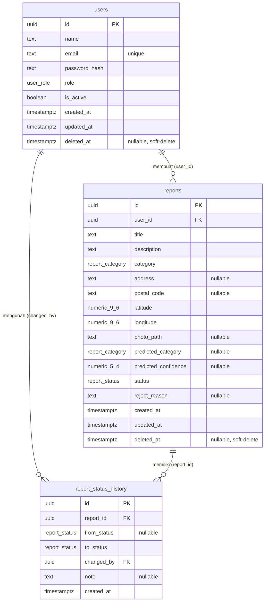

# ERD — Lapor Sampah

Sumber: `be/src/db/schema.ts`, `be/drizzle/0000_easy_jackpot.sql`,
`be/drizzle/0001_absurd_squadron_supreme.sql`. Database: PostgreSQL 14+.

## Diagram

## Enum

| Enum              | Nilai                                             |
| ----------------- | ------------------------------------------------- |
| `user_role`       | `admin`, `user`                                   |
| `report_category` | `organic`, `plastic`, `paper`                     |
| `report_status`   | `pending`, `in_progress`, `completed`, `rejected` |

## Tabel

### `users`

| Kolom           | Tipe          | Null     | Default             | Keterangan                                 |
| --------------- | ------------- | -------- | ------------------- | ------------------------------------------ |
| `id`            | `uuid`        | NOT NULL | `gen_random_uuid()` | PK                                         |
| `name`          | `text`        | NOT NULL | —                   | —                                          |
| `email`         | `text`        | NOT NULL | —                   | Unique (`users_email_unique`)              |
| `password_hash` | `text`        | NOT NULL | —                   | bcrypt, tidak pernah diekspos via API      |
| `role`          | `user_role`   | NOT NULL | `'user'`            | Index `users_role_idx`                     |
| `is_active`     | `boolean`     | NOT NULL | `true`              | `false` = dinonaktifkan admin              |
| `created_at`    | `timestamptz` | NOT NULL | `now()`             | —                                          |
| `updated_at`    | `timestamptz` | NOT NULL | `now()`             | —                                          |
| `deleted_at`    | `timestamptz` | nullable | —                   | Soft delete; query normal filter `IS NULL` |

### `reports`

| Kolom                  | Tipe              | Null     | Default             | Keterangan                                                              |
| ---------------------- | ----------------- | -------- | ------------------- | ----------------------------------------------------------------------- |
| `id`                   | `uuid`            | NOT NULL | `gen_random_uuid()` | PK                                                                      |
| `user_id`              | `uuid`            | NOT NULL | —                   | FK → `users.id` (`restrict`)                                            |
| `title`                | `text`            | NOT NULL | —                   | —                                                                       |
| `description`          | `text`            | NOT NULL | —                   | —                                                                       |
| `category`             | `report_category` | NOT NULL | —                   | Kategori final (bisa dikoreksi user)                                    |
| `address`              | `text`            | nullable | —                   | Alamat teks opsional                                                    |
| `postal_code`          | `text`            | nullable | —                   | Ditambah migrasi `0001`                                                 |
| `latitude`             | `numeric(9,6)`    | NOT NULL | —                   | -90–90                                                                  |
| `longitude`            | `numeric(9,6)`    | NOT NULL | —                   | -180–180                                                                |
| `photo_path`           | `text`            | nullable | —                   | Nama file di `UPLOAD_DIR`; API memetakan ke `photoUrl: /uploads/<file>` |
| `predicted_category`   | `report_category` | nullable | —                   | Hasil model ONNX, `null` jika tanpa foto / klasifikasi gagal            |
| `predicted_confidence` | `numeric(5,4)`    | nullable | —                   | 0–1                                                                     |
| `status`               | `report_status`   | NOT NULL | `'pending'`         | Lihat alur di `API.md`                                                  |
| `reject_reason`        | `text`            | nullable | —                   | Wajib saat `rejected`, `null` selain itu                                |
| `created_at`           | `timestamptz`     | NOT NULL | `now()`             | —                                                                       |
| `updated_at`           | `timestamptz`     | NOT NULL | `now()`             | —                                                                       |
| `deleted_at`           | `timestamptz`     | nullable | —                   | Soft delete                                                             |

Index: `reports_user_id_idx (user_id)`, `reports_status_idx (status)`,
`reports_category_idx (category)`, `reports_created_at_idx (created_at)`.

### `report_status_history`

| Kolom         | Tipe            | Null     | Default             | Keterangan                                  |
| ------------- | --------------- | -------- | ------------------- | ------------------------------------------- |
| `id`          | `uuid`          | NOT NULL | `gen_random_uuid()` | PK                                          |
| `report_id`   | `uuid`          | NOT NULL | —                   | FK → `reports.id` (`cascade`)               |
| `from_status` | `report_status` | nullable | —                   | `null` untuk entri pertama (`pending` awal) |
| `to_status`   | `report_status` | NOT NULL | —                   | —                                           |
| `changed_by`  | `uuid`          | NOT NULL | —                   | FK → `users.id` (`restrict`)                |
| `note`        | `text`          | nullable | —                   | Alasan penolakan / catatan transisi         |
| `created_at`  | `timestamptz`   | NOT NULL | `now()`             | Urutan riwayat `asc`                        |

Index: `report_history_report_id_idx (report_id)`.

## Relasi & perilaku hapus

- `users 1—N reports`: `reports.user_id → users.id` dengan `ON DELETE restrict`.
  User yang masih punya laporan tidak bisa dihapus hard; aplikasi memakai soft delete
  (`deleted_at`, `is_active = false`).
- `reports 1—N report_status_history`: `ON DELETE cascade`.
  Hapus laporan (hard delete di level DB) ikut menghapus riwayatnya.
- `users 1—N report_status_history`: `changed_by → users.id` dengan `ON DELETE restrict`.
  Mencegah penghapusan user yang tercatat di riwayat.
- Tidak ada tabel join; semua relasi one-to-many. Tidak ada FK dari `users` ke tabel lain.
